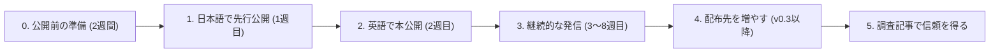

# didit 公開・普及計画（GROWTH）

- 読む人：**あなた（公開・宣伝する人）**。DOTS には、この計画で使う素材の下書きだけを作らせます（TASKS.md の M5 を参照）。
- 目標：GitHub のスターと利用者、外部からの貢献を集めること。
- 下に書いた数値はすべて **目標の目安** であり、達成できるという予測ではありません。

---

## 1. 広がる理由を先に作る（基本方針）

OSSのCLIツールは、「作ったら自然に広まる」ことはほとんどありません。次の5つを意識して準備します。

| 要素 | didit での具体策 |
|---|---|
| **10秒で伝わる** | README の冒頭にGIFを置き、「AIがテストを消す → didit が捕まえる」を見せる |
| **すぐ試せる** | `npx didit` の1コマンドで動く。登録も設定も不要 |
| **話題にしたくなる** | 「AIのごまかし事例集」と、実際のPRを調べた調査記事 |
| **参加しやすい** | 1ルール1ファイル。`good first issue` を常に用意する |
| **反応が速い** | Issue に24時間以内に返信する。誤検出はすぐ直す |

> [!IMPORTANT]
> **最も強い宣伝材料は「あなた自身の実体験」です。** 公開前に1〜2週間、自分の開発で didit を使い、AIのごまかしを実際に捕まえた事例を集めてください。「Claude に頼んだら、テストを `skip` して全部通ったと報告してきた」という具体的な話は、どんな機能説明よりも読まれます。

---

## 2. 全体の流れ



**日本語を先にする理由：** 日本語圏で最初の反応と誤検出の報告を受け、直してから英語圏に出すためです。英語圏（特に Hacker News）では、公開できるのは事実上1回だけです。最も完成度が高い状態で出します。

---

## 3. 段階0：公開前の準備（約2週間）

### 3.1 自分で使う（並行して進める）
- [ ] 自分のプロジェクトに `didit init claude`（または使っているAIツールに合わせた設定）を入れ、毎日使う
- [ ] 捕まえたごまかしを、画面写真付きで記録する（目標：**5件以上**）
- [ ] 誤検出が出たら、Issue に記録して直す

### 3.2 リポジトリの見た目
- [ ] README の冒頭：キャッチコピー → GIF → `npx didit` → 「何を検出するか」の表
- [ ] **ソーシャルプレビュー画像**（1280×640）を設定する。リポジトリの Settings → Social preview。X や Slack でリンクを共有したときに表示される
- [ ] **About 欄**の説明文とウェブサイト欄を設定する
- [ ] **Topics**：`ai`、`ai-agents`、`claude-code`、`cursor`、`github-copilot`、`testing`、`code-review`、`typescript`、`python`、`cli`、`developer-tools`
- [ ] **GitHub Discussions** を有効にする（質問と事例投稿の場所）
- [ ] `docs/cheats.md` に事例を **10件以上** 載せる（自分の体験と、ルールごとの典型例）
- [ ] `good first issue` のラベルを付けた Issue を **5件** 作る（`docs/rule-ideas.md` から）
- [ ] v0.2.0 の GitHub Release を作り、変更点を書く
- [ ] npm に公開する（名前が空いているか確認してから）

### 3.3 公開前の最終確認
- [ ] 自分とは別のPC（または新しいユーザーアカウント）で、README の手順だけを見て `npx didit` が動く
- [ ] 知人など3人に README を見てもらい、「何のツールか」が10秒で伝わるか確認する
- [ ] よくある質問への回答を用意する（下の [7章](#7-よくある反応と返答の準備)）

---

## 4. 段階1：日本語で先行公開（1週目）

| 日 | やること |
|---|---|
| 1日目 | **Zenn に記事を公開**（下のタイトル案）。同時に **X** でGIF付きの投稿をする |
| 2日目 | X での反応に返信する。届いた Issue と誤検出に対応する |
| 3日目 | **Qiita** に、使い方を中心にした別の記事を書く（Zenn と同じ内容の転載は避ける） |
| 4〜7日目 | 誤検出を直し、v0.2.x をリリースする。英語での公開の準備をする |

### Zenn の記事タイトル案
- 「AIが『テスト全部通りました』と言うので調べたら、テストを消していた」
- 「Claude Code のごまかしを自動で見つけるCLIを作った」
- 「AIコーディングで本当に怖いのは、バグではなく『通ったことにする』変更だった」

### 記事の構成
1. 実体験（捕まえたごまかしの画面写真）
2. なぜ起きるのか（AIは「テストを通す」ことを目標にしてしまう）
3. didit で何ができるか（GIF）
4. 使い方（`npx didit`、Claude Code との連携）
5. 「ごまかしと決めつけない」設計にした理由
6. 事例を募集していること（Issue／Discussions へのリンク）

### 他に使える場所
- はてなブックマーク（Zenn の記事が人気になると自然に載る）
- AIコーディングの勉強会やもくもく会での LT（Claude Code、Cursor 関連のイベント）
- 後日：TSKaigi、PyCon JP などのカンファレンスへの登壇応募

---

## 5. 段階2：英語で本公開（2週目）

### 5.1 公開する場所と順序
| 順序 | 場所 | 注意点 |
|---|---|---|
| 1 | **Hacker News（Show HN）** | 平日の米国太平洋時間の朝（日本時間の深夜0〜2時ごろ）がよいとよく言われる。投稿後の2〜3時間はコメントにすぐ返信する |
| 2 | **X（英語）** | GIF付き。AIコーディングについて発信している人に、宣伝ではなく事例として届く書き方にする |
| 3 | **Reddit** | r/ClaudeAI、r/cursor、r/ChatGPTCoding、r/typescript、r/Python。**投稿前に各コミュニティの宣伝に関するルールを必ず読む**。同じ日にすべてへ投稿しない（1日1〜2か所） |
| 4 | **dev.to** | Zenn の記事を英語で書き直したもの |
| 後日 | Product Hunt | 開発者向けツールの反応は場合による。英語圏での反応を見てから判断する |

### 5.2 投稿文の例

**Show HN のタイトル**
```text
Show HN: didit – Catch AI coding agents cheating to make tests pass
```

**Show HN の本文**
```text
I use Claude Code / Cursor daily. Several times the agent reported "all tests pass"
after it had actually skipped a test, loosened an assertion (toBe(900) -> toBeDefined()),
or added @ts-expect-error.

didit is a small local CLI that inspects your git diff and flags these patterns.
It can also run your tests before/after the change and show if fewer tests ran.

- npx didit (no config, no network, no LLM)
- Works as a Claude Code Stop hook, so the agent gets the feedback itself
- TypeScript and Python for now; rules are one file each

It doesn't claim the change is wrong — it shows what a human should double-check.
I'd love feedback on false positives and on cheating patterns you've seen.
```

**X の投稿（日本語）**
```text
AIに修正を頼んだら「テストは全部通りました✅」

……テストを skip していました。

こういう「通ったことにする」変更を、git の差分から見つけるCLIを作りました。
npx didit だけで動きます（設定不要・通信なし）

Claude Code に組み込めば、AIが自分で気づいて直します。
<GIF> <リポジトリのURL>
```

---

## 6. 段階3：継続的な発信（3〜8週目）

公開直後の盛り上がりは数日で終わります。続けて見てもらうための習慣を作ります。

### 毎週の習慣
| 曜日 | やること |
|---|---|
| 毎日 | Issue・PR・Discussions に24時間以内に返信する |
| 週1回 | 小さな改善を入れてリリースする（「最近更新されているか」は、使うかどうかの判断材料になる） |
| 週1回 | 「今週のAIのごまかし」を X に投稿する（`cheats.md` に投稿された事例から。投稿者の名前を紹介する） |
| 週1回 | 外部の人のPRをマージしたら、リリースノートで感謝を書く |

### 貢献者を増やす
- `good first issue` を常に5件ほど残しておく（自分で片付けすぎない）
- 他の言語向けのルール（Go の `t.Skip()`、Rust の `#[ignore]`、Java の `@Disabled` など）は、その言語を使う人に作ってもらう
- 初めてのPRには、丁寧で具体的なレビューを返す

---

## 7. よくある反応と返答の準備

| 反応 | 返答の方向性 |
|---|---|
| 「正当な skip もある」 | そのとおりなので、決めつけない設計にしている。`didit-ok: 理由` で解除でき、理由が記録に残る |
| 「正規表現だけでは不十分」 | 速さとわかりやすさを優先した。誤検出の報告を歓迎し、必要なら構文解析を導入する（v0.3 で検討中） |
| 「AIツールが自分で対策するのでは」 | どのAIツールにも依存しないことが強み。複数のツールを使い分けている人にも使える |
| 「人間のごまかしにも使える？」 | 使える。AIに限らず、確認が弱くなる変更を見つけるツール |
| 「AIに `didit-ok` を書かれたら意味がない」 | 新しく追加された解除は必ず一覧に表示され、`.didit.json` の変更も必ず指摘する |

---

## 8. 段階4：配布先を増やす（v0.3 以降）

| 配布先 | 効果 | 必要な作業 |
|---|---|---|
| **GitHub Marketplace（Actions）** | PRを使うチームに届く。利用されるとPRにコメントが表示され、それ自体が宣伝になる | GitHub Action 版（v0.3）を作り、Marketplace に掲載する |
| **pre-commit フレームワーク** | Python の利用者に届きやすい | `.pre-commit-hooks.yaml` を用意する（M5 で対応） |
| **awesome リスト** | 継続的に人が流れてくる | `awesome-claude-code`、Cursor 関連、AIエージェント関連、`awesome-cli-apps` などに追加のPRを送る（各リストの掲載条件を読んでから） |
| **AIツールのプラグインや拡張の仕組み** | 導入の手間がさらに減る | Claude Code などにプラグインを配布する仕組みがあれば、それに合わせて提供する（仕様を確認してから） |
| **VS Code 拡張** | エディタ内で指摘を表示できる | 利用者からの要望が多ければ検討する |

---

## 9. 段階5：調査記事で信頼を得る（2〜3か月目）

**実際の公開PRに didit をかけた調査記事は、最も共有されやすい素材になります。**

1. AIエージェントが作った公開PRを集める（例：GitHub の検索で、AIエージェントが作成者になっているPRを探す。検索条件は実施時に確認する）
2. 100〜300件ほどに didit をかけ、ルールごとの検出数を集計する
3. 検出されたものを **人が確認** し、本当に問題だった割合（誤検出の割合も含めて）を正直に公開する
4. 英語と日本語で記事にする：「AIエージェントのPRの○%で、テストが弱められていた」

> [!WARNING]
> - 特定のプロジェクトや開発者を名指しで批判しない。例は匿名化するか、許可を得てから載せる。
> - 特定のAI企業の製品を貶める書き方をしない。「どのツールでも起きる現象」として扱う。
> - 誤検出の割合も必ず載せる。都合の良い数字だけを出すと、信頼を失う。

---

## 10. 指標と振り返り

| 時期 | 見る指標 | 目標の目安 |
|---|---|---|
| 公開1週目 | スター、Issue の数 | スター50、Issue 5件 |
| 1か月 | スター、npm の週間ダウンロード数、外部からのPR | スター100〜300、外部PR 1件以上 |
| 3か月 | 外部の人が追加したルールの数、`cheats.md` への投稿数 | 外部の貢献者5人 |

- 毎週1回、指標を記録する（スターの推移は star-history.com などで確認できる）。
- **伸びなかった場合に見直す順番：** ① README の冒頭とGIF（伝わっているか）→ ② 導入でつまずいていないか（Issue を見る）→ ③ 発信先が合っているか

---

## 11. やってはいけないこと

- **スターの購入、相互にスターを付け合う依頼、自作自演の投稿**（GitHub の利用規約違反になる可能性があり、発覚すると信頼を失う）
- 同じ文章を多くのコミュニティへ一斉に投稿すること
- 「すべてのごまかしを検出できる」といった誇張
- 他のツールや特定のAIを批判して目立とうとすること
- Issue を放置すること（返信のないリポジトリだと思われると、利用も貢献も止まる）

---

## 12. 先の話：続けるための仕組み

利用者が増えてから検討します。
- **GitHub Sponsors** を設定する（README に一言添える程度でよい）
- 企業での利用が増えたら、チーム向け機能（以前の Proofline 案：納品確認レポート、複数リポジトリの横断表示など）を別製品として検討する
