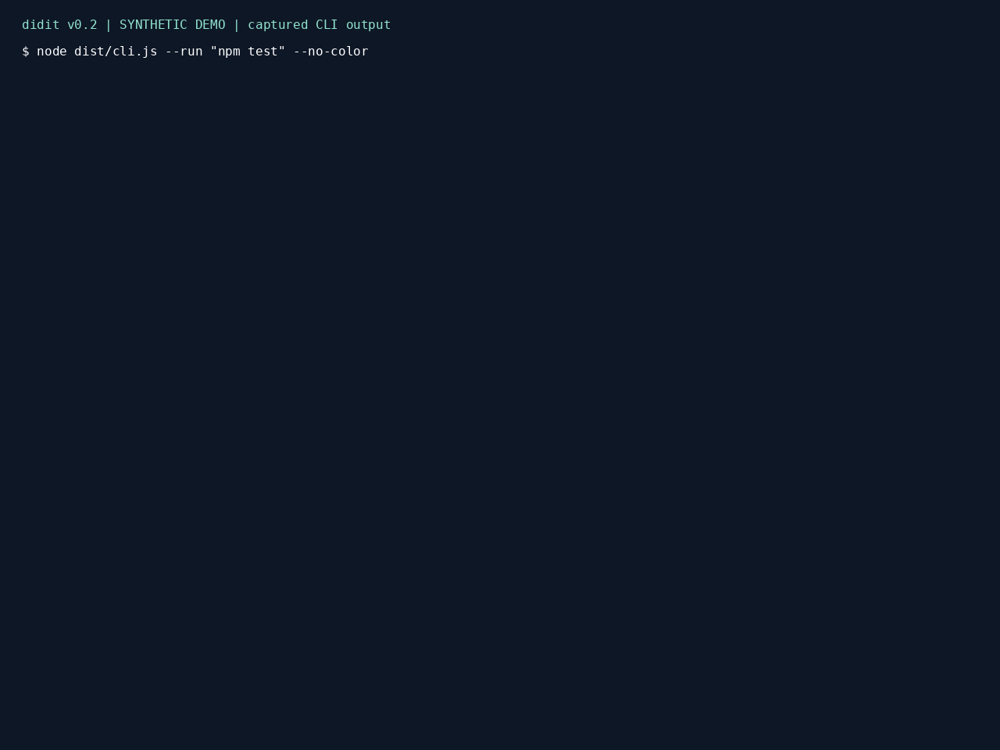

This is an unpublished launch draft. Verify the final repository URL, package identity, release status, and evidence before publication.

## Personal experience

<!-- TODO: 実体験を書く -->

## A green run is only part of the evidence

A test command can exit successfully after tests are skipped or assertions become less specific. That does not establish why the author changed them. It does mean that reviewing only the final command output can miss an important part of the change.

## Inspect the diff



didit checks Git diffs for 20 patterns across TS/JS, Python, and configuration: disabled or removed tests, weaker assertions, changed expectations, error suppressions, relaxed checks, swallowed exceptions, and test-only production branches. Three more rules inspect actual command outcomes and parsed counts when execution is requested.

The demo is constructed, not a personal anecdote. A small Node harness runs assertions and prints Vitest-style summaries. The baseline has three passing tests; the modified version has two passing and one skipped. didit reports five high findings and one medium finding with exit code 1. Multiple findings can describe the same underlying change.

## Try the unpublished preview

In a trusted checkout, run `npm ci`, `npm run build`, and `npm pack`. In the Git repository you want to inspect:

```sh
npm install --save-dev /absolute/path/to/didit-0.2.0.tgz
npx --no-install didit
npx --no-install didit --run "npm test"
npx --no-install didit --handoff --goal "Fix the discount calculation"
```

The provisional registry name is not verified. Do not fetch `npx didit` from npm. Local installation and dependencies can require network access even though static analysis does not.

## Put review feedback into an agent workflow

`npx --no-install didit init claude` adds a Stop hook; agents, cursor, and copilot targets add instruction files. Generated hook commands, instructions, and handoff advice use `npx --no-install didit`, requiring a trusted local installation rather than downloading a missing package. Initialization is idempotent. See the README for exact behavior and distinct hook exit codes.

## Keep legitimate exceptions visible

An intentional skip can carry `didit-ok(test-skip-added): reason`. New suppression comments remain listed. Changes to `.didit.json` cannot suppress their own configuration-change finding. The goal is a reviewable explanation, not an accusation.

## Limits matter

This is heuristic detection, not a proof of correctness. Unsupported syntax can be missed; legitimate test moves can be flagged. Command execution is not sandboxed, may change files or use the network, and dependency links can share mutable state. Staged and empty snapshots lack HEAD. Runtime comparisons require comparable runs and successfully parsed counts.

No test execution is claimed when none occurred. Handoff reports separate actual evidence from filename-based guesses about related tests. CI matrix configuration does not mean all platforms have passed.

## Feedback and next steps

The first-party code is MIT. Feedback should include sanitized before/after examples and what the tool ought to report. Potential starter contributions include scoped Go/Rust/Java rules, but those languages are not claimed as supported today.

TODO: insert verified repository/issues links, adapt the GIF URL for dev.to, confirm current publication facts, and fill only genuine personal experience. Do not publish this draft automatically.
